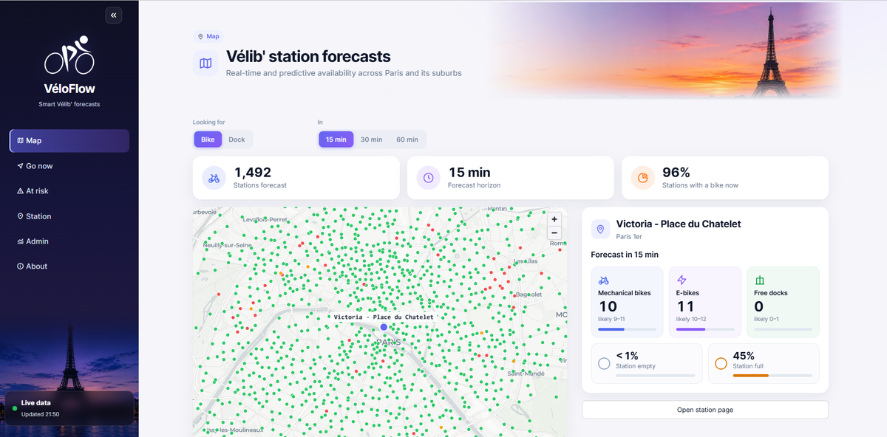
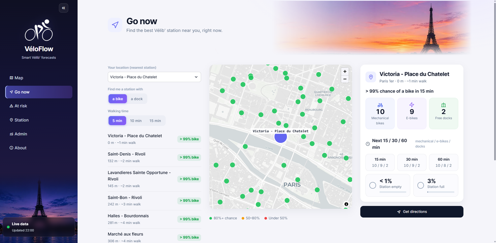
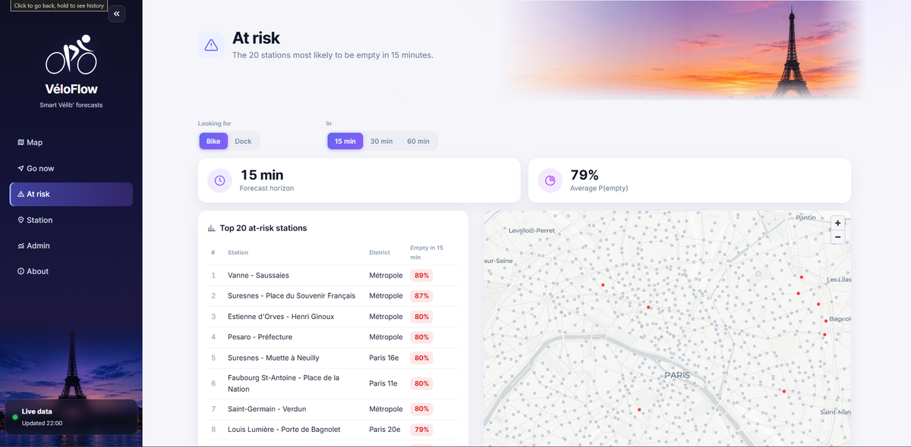
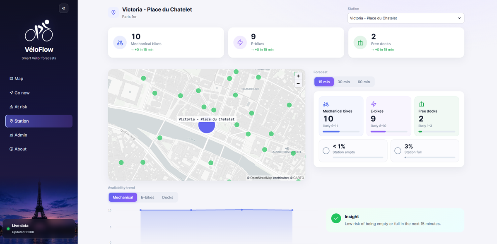
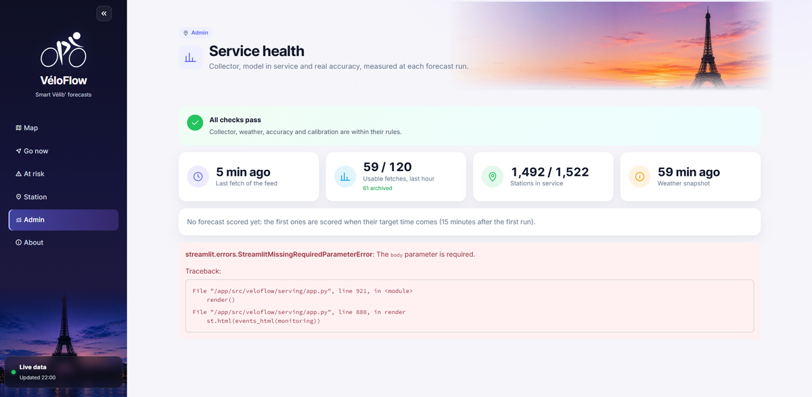
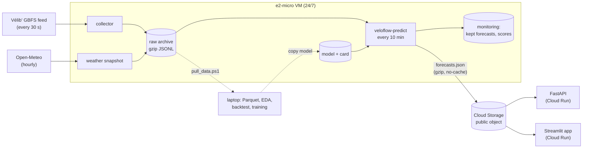

# VéloFlow

[](https://github.com/HamzaOuba00-1/veloflow/actions/workflows/ci.yml)

Station-level forecasts for the Vélib' Métropole bike-sharing network in Paris:
for each of the ~1,500 stations, how many mechanical bikes, e-bikes and free
docks there will be in 15, 30 and 60 minutes, with 80 % intervals and
calibrated probabilities that the station will be empty or full. Live, updated
every 10 minutes, on free-tier infrastructure.

**Live:** [web app](https://veloflow-app-235721892563.us-east1.run.app) ·
[API docs](https://veloflow-api-235721892563.us-east1.run.app/docs) ·
[service health](https://veloflow-api-235721892563.us-east1.run.app/status)
(the services sleep when unused: the first visit takes a few seconds)



| Go now? | At risk | Station | Admin |
|---|---|---|---|
|  |  |  |  |

## What it answers

- **Riders**: "Will there be a bike (or a dock) at my station when I get
  there? If not, which station nearby?" (*Go now*, *Map*, *Station*).
- **Operators**: "Which stations will be empty or full within the hour?"
  (*At risk*, ranked by probability).
- **Whoever runs it**: "Is the collector healthy, which model is in service,
  and does it beat doing nothing, today, on real traffic?" (*Admin*).

## How it works



1. **Collection** ([deployment](docs/deployment.md)): the feed is fetched
   every 30 seconds since 8 November 2026 and archived raw; a nightly job
   compacts it to Parquet. Monitored by healthchecks.io.
2. **Quality** ([rules](docs/data/quality.md)): stale versions, closed
   stations and frozen feeds are detected and masked, never silently fixed.
3. **Features and model** ([features](docs/models/features.md),
   [model](docs/models/gbm.md)): one global LightGBM per horizon forecasts
   the *change* from now (lags, station profile, neighbours, weather, calendar);
   split-conformal 80 % intervals; isotonic-calibrated empty/full
   probabilities.
4. **Evaluation** ([protocol](docs/evaluation/backtest.md)): rolling origin,
   one Paris day at a time, against persistence and profile baselines, with an
   automatic look-ahead check and the acceptance criteria of the design.
5. **Serving** ([serving](docs/serving.md)): the VM forecasts every station
   and publishes one JSON document; the API and the app only read it. The VM
   also scores its own past forecasts against what happened: real accuracy
   per horizon, against persistence, on the Admin page.

Cards and status: [model card](docs/cards/model_card.md) ·
[data card](docs/cards/data_card.md) ·
[Definition of Done, box by box](docs/definition_of_done.md).

## Results

Measured, with the amount of data in mind: the history started on 8 November
2026, so these first backtests train on one or two days.

Backtest on 9-10 November 2026 (rolling origin, frozen stations left out):

| Horizon | MAE mechanical bikes, LightGBM / persistence | `empty` ranking (average precision), LightGBM / calibrated persistence | `empty` Brier / calibration error |
|---|---|---|---|
| 15 min | 0.324 / 0.323 | **0.72** / 0.64 | 0.021 / 0.002 |
| 30 min | 0.534 / 0.529 | **0.58** / 0.50 | 0.028 / 0.005 |
| 60 min | 0.849 / 0.840 | **0.44** / 0.38 | 0.033 / 0.005 |

- **Counts**: the model matches persistence ("nothing changes"), it does not
  beat it yet. Persistence is a strong reference at 15-60 minutes, and a
  station profile learned from one weekday is weak. The acceptance criterion
  "10 to 30 % below persistence" fails, and is reported as such.
- **Empty stations**: the model ranks the stations at risk clearly better than
  calibrated persistence, with the same calibration.
- **Intervals** are valid but too wide (82.7-90.5 % coverage for 80 %):
  counts are whole numbers, and `± 0` to `± 1` jumps past the target.
- **Subgroups** (suburbs, peak hours, rain) do not degrade more than 15 %.
- LightGBM passes **21 of 38** acceptance checks.
- In production: 1,496 stations forecast in 25 s on the VM (360 MB peak);
  the API answers in 10-70 ms; the document weighs 134 KB gzipped.

Real accuracy since the deployment is on the [Admin page](https://veloflow-app-235721892563.us-east1.run.app):
it is measured continuously, not copied here, so it never goes stale.

## Quick start

Requirements: [uv](https://docs.astral.sh/uv/) and Git (uv installs Python).
Three commands run the app on the live forecasts (PowerShell; use `export`
in bash):

```powershell
uv sync
$env:VELOFLOW_FORECASTS = "https://storage.googleapis.com/veloflow-forecasts-513808/forecasts.json"
uv run veloflow-app            # http://localhost:8501   (or: uv run veloflow-api)
```

The whole pipeline, on your own data:

```powershell
uv run veloflow-collector                         # collect (runs forever)
uv run veloflow-compact --data-dir data --all     # raw archive -> Parquet
uv run veloflow-backtest --data-dir data          # evaluate every model
uv run veloflow-train --data-dir data             # train the model in service
uv run veloflow-predict --data-dir data           # forecast now -> data/serving/forecasts.json
```

## Engineering

- One installable package (`src/veloflow`); the collector, the API, the app
  and the scripts only import it.
- 374 tests, 98 % coverage, `mypy --strict`, ruff, 12 pre-commit hooks; CI
  runs them on every push and builds the serving image.
- Degraded cases tested: feed down, partial or malformed response, unknown or
  vanished station, broken or unreachable forecast document, failed monitoring.
- Infrastructure as code (`infra/`): VM setup, systemd units with memory caps
  and sandboxing, bucket, Cloud Run deployment. Least privilege: the VM's
  service account can write one bucket; no key file exists; secrets stay in
  the VM's environment file.
- Free tier: e2-micro VM, Cloud Storage in us-east1, Cloud Run scaled to zero.

## Repository

```text
src/veloflow/
  collector/   GBFS client, 30-second collector, raw archive
  storage/     compaction to Parquet
  quality/     versions, operational stations, frozen feeds, coverage
  weather/ context/   Open-Meteo, school holidays, bike counts
  features/    feature grid (lags, profiles, neighbours, weather, calendar)
  models/      baselines, LightGBM, training, saved artefacts
  evaluation/  examples, rolling-origin backtest, metrics, acceptance criteria
  serving/     live forecast, publication, monitoring, API, app
infra/         VM (systemd), Google Cloud scripts, data sync
docs/          data, models, evaluation, serving, deployment
```

## Limits and next steps

- **Little history**: about a week of data, no summer, no school holidays
  yet. Every result above will be rerun as the history grows.
- Counts do not beat persistence yet; intervals over-cover (asymmetric or
  per-group conformal intervals are the next try).
- Not done: "your station is emptying" alerts (F7), rebalancing simulation
  (F8), data versioning with DVC, champion/challenger with rollback.
- The model is retrained on the laptop and copied by hand to the VM.

## License

The code is released under the [MIT License](LICENSE).

Data sources and their terms:

- Vélib' Métropole availability: [Open Database License (ODbL)](https://opendatacommons.org/licenses/odbl/1-0/).
- Weather forecasts: [Weather data by Open-Meteo.com](https://open-meteo.com/),
  [CC BY 4.0](https://creativecommons.org/licenses/by/4.0/), from Météo-France
  models. Free API, non-commercial use.
- Bike counts: Ville de Paris, Direction de la Voirie et des Déplacements,
  [ODbL](https://opendatacommons.org/licenses/odbl/1-0/).
- French school calendar: Ministère de l'Éducation nationale,
  [Licence Ouverte 2.0](https://www.etalab.gouv.fr/licence-ouverte-open-licence/).
- Pictures and font of the app: see [CREDITS.md](src/veloflow/serving/static/images/CREDITS.md).
