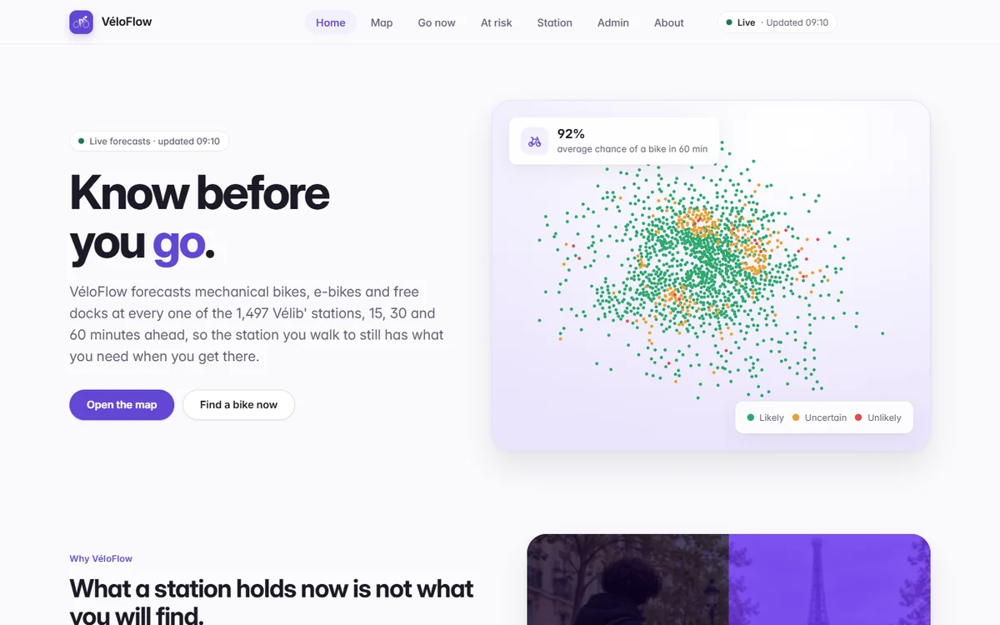
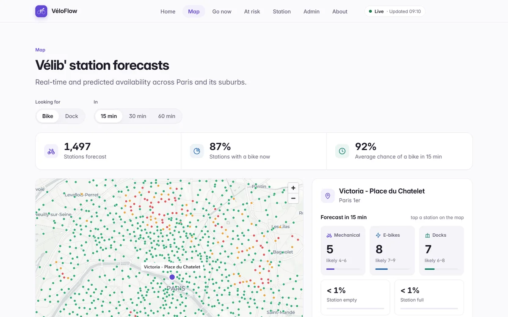
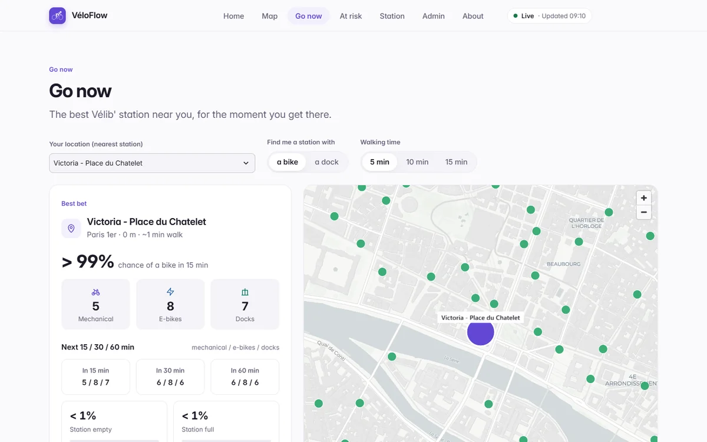
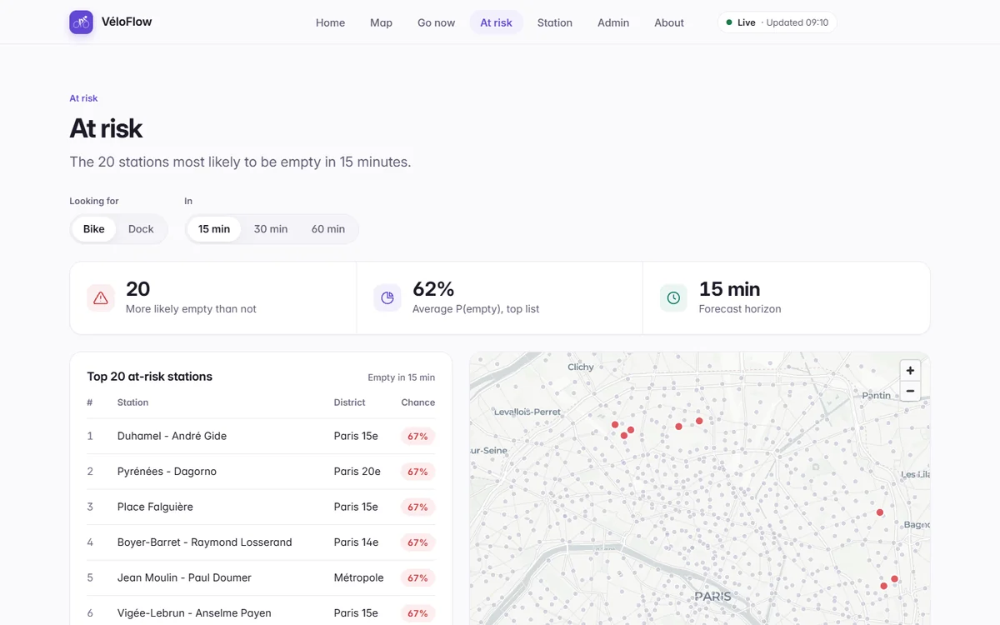
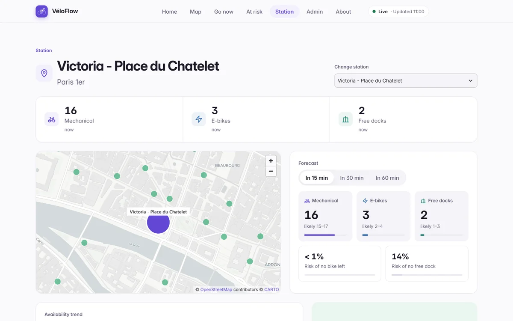
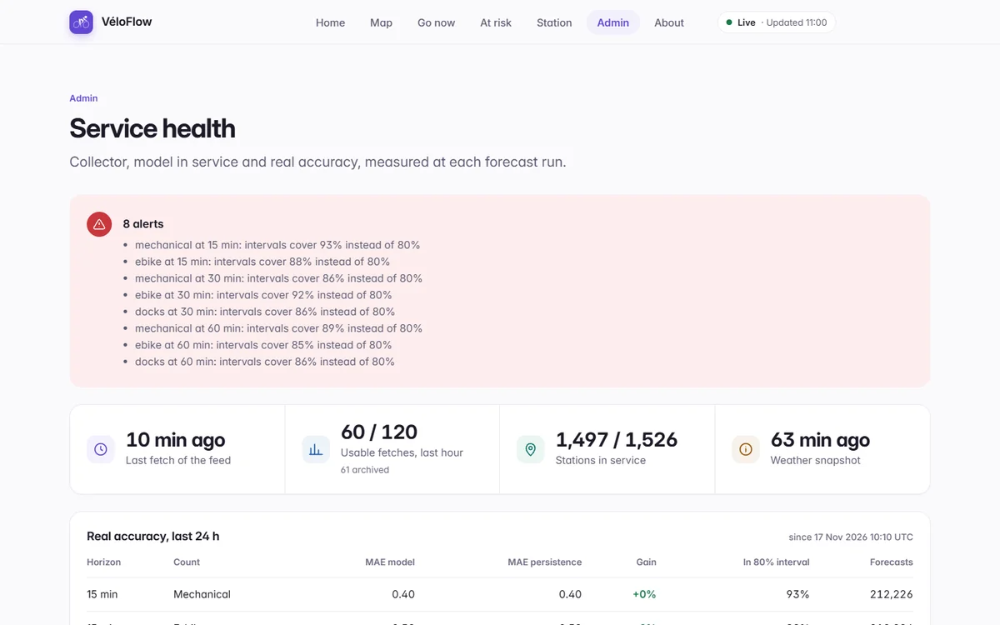
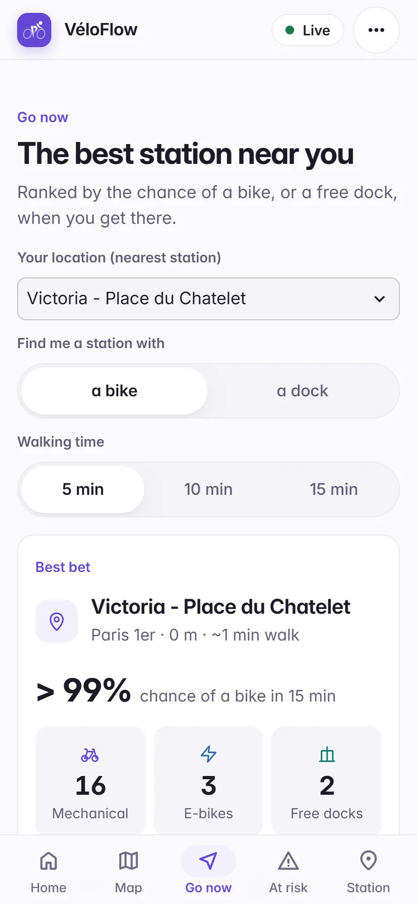
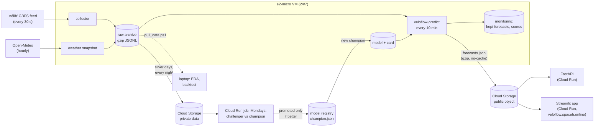

# VéloFlow

[](https://github.com/HamzaOuba00-1/veloflow/actions/workflows/ci.yml)

Station-level forecasts for the Vélib' Métropole bike-sharing network in Paris:
for each of the ~1,500 stations, how many mechanical bikes, e-bikes and free
docks there will be in 15, 30 and 60 minutes, with 80 % intervals and
calibrated probabilities that the station will be empty or full. Live, updated
every 10 minutes, on free-tier infrastructure.

**Live:** [web app](https://veloflow.spaceh.online) ·
[API docs](https://veloflow-api-235721892563.us-east1.run.app/docs) ·
[service health](https://veloflow-api-235721892563.us-east1.run.app/status)
(the services sleep when unused: the first visit takes a few seconds)



| Map | Go now? |
|---|---|
|  |  |
| **At risk** | **Station** |
|  |  |
| **Admin** | **On a phone** |
|  |  |

Screenshots of the live app, taken by `scripts/assets/screenshots.py`; every
figure on them comes from the forecast document of that moment.

## What it answers

- **Riders**: "Will there be a bike (or a dock) at my station when I get
  there? If not, which station nearby?" (*Go now*, *Map*, *Station*).
- **Operators**: "Which stations will be empty or full within the hour?"
  (*At risk*, ranked by probability).
- **Whoever runs it**: "Is the collector healthy, which model is in service,
  and does it beat doing nothing, today, on real traffic?" (*Admin*).

## How it works



1. **Collection** ([deployment](docs/deployment.md)): the feed is fetched
   every 30 seconds since 8 November 2026 and archived raw; a nightly job
   compacts it to Parquet. Monitored by healthchecks.io.
2. **Quality** ([rules](docs/data/quality.md)): stale versions, closed
   stations and frozen feeds are detected and masked, never silently fixed.
3. **Features and model** ([features](docs/models/features.md),
   [model](docs/models/gbm.md)): one global LightGBM per horizon forecasts
   the *change* from now (lags, station profile, neighbours, weather, calendar);
   split-conformal 80 % intervals; isotonic-calibrated empty/full
   probabilities.
4. **Evaluation** ([protocol](docs/evaluation/backtest.md)): rolling origin,
   one Paris day at a time, against persistence and profile baselines, with an
   automatic look-ahead check and the acceptance criteria of the design.
5. **Serving** ([serving](docs/serving.md)): the VM forecasts every station
   and publishes one JSON document; the API and the app only read it. The VM
   also scores its own past forecasts against what happened: real accuracy
   per horizon, against persistence, on the Admin page.

Cards and status: [model card](docs/cards/model_card.md) ·
[data card](docs/cards/data_card.md) ·
[Definition of Done, box by box](docs/definition_of_done.md).

## Tech stack

| Layer | Tools | Role in VéloFlow |
|---|---|---|
| Data | Python 3.12, Polars, Parquet (zstd), Pydantic, httpx | Collect the feed every 30 s, validate it, store a raw archive and a daily columnar layer |
| Machine learning | LightGBM, scikit-learn | Gradient-boosted forecasts per horizon, isotonic calibration, split-conformal intervals |
| Evaluation | Own rolling-origin backtest | Persistence and profile baselines, look-ahead test, MAE, Brier, calibration, coverage |
| Serving | FastAPI, Uvicorn, Streamlit, pydeck, Altair | REST API with OpenAPI docs; web app with maps and charts, desktop and phone layouts |
| Cloud (Google Cloud) | Compute Engine (Shielded VM), Cloud Storage, Cloud Run services and jobs, Cloud Scheduler, Cloud Build, Artifact Registry, IAM, Identity-Aware Proxy | VM running 24/7, public forecast document, two services scaled to zero, weekly training job, image built from the sources, one service account per job, SSH without an open port |
| MLOps | Model registry in Cloud Storage, champion/challenger | Weekly retraining, promotion only when no worse on the holdout, every decision recorded, one-command rollback |
| Delivery | Docker, GitHub Actions, pip-audit, uv, systemd | One image for the API, the app and the training job, CI on every push, weekly vulnerability audit, locked dependencies, sandboxed services on the VM |
| Quality | pytest, mypy `--strict`, ruff, pre-commit | Tests and static checks run locally and in CI |
| Operations | healthchecks.io, Cloud Billing budget, custom domain with managed TLS | Alerts when a job stops, cost guard at 1 USD a month, `veloflow.spaceh.online` |

## Results

Measured, with the amount of data in mind: the history started on 8 November
2026, so these first backtests train on one or two days.

Backtest on 9-10 November 2026 (rolling origin, frozen stations left out):

| Horizon | MAE mechanical bikes, LightGBM / persistence | `empty` ranking (average precision), LightGBM / calibrated persistence | `empty` Brier / calibration error |
|---|---|---|---|
| 15 min | 0.324 / 0.323 | **0.72** / 0.64 | 0.021 / 0.002 |
| 30 min | 0.534 / 0.529 | **0.58** / 0.50 | 0.028 / 0.005 |
| 60 min | 0.849 / 0.840 | **0.44** / 0.38 | 0.033 / 0.005 |

- **Counts**: the model matches persistence ("nothing changes"), it does not
  beat it yet. Persistence is a strong reference at 15-60 minutes, and a
  station profile learned from one weekday is weak. The acceptance criterion
  "10 to 30 % below persistence" fails, and is reported as such.
- **Empty stations**: the model ranks the stations at risk clearly better than
  calibrated persistence, with the same calibration.
- **Intervals** are valid but too wide (82.7-90.5 % coverage for 80 %):
  counts are whole numbers, and `± 0` to `± 1` jumps past the target.
  Per-group (Mondrian) bounds, chosen apart below and above, now narrow them
  by 18 % on 13-17 November (coverage 82.1-87.0 %, against 82.5-94.1 % for
  `± k`; [details](docs/models/gbm.md)).
- **Subgroups** (suburbs, peak hours, rain) do not degrade more than 15 %.
- LightGBM passes **21 of 38** acceptance checks.
- In production: 1,496 stations forecast in 25 s on the VM (360 MB peak);
  the API answers in 10-70 ms; the document weighs 134 KB gzipped.

Real accuracy since the deployment is on the [Admin page](https://veloflow.spaceh.online/?page=admin):
it is measured continuously, not copied here, so it never goes stale.

## Quick start

Requirements: [uv](https://docs.astral.sh/uv/) and Git (uv installs Python).
Three commands run the app on the live forecasts (PowerShell; use `export`
in bash):

```powershell
uv sync
$env:VELOFLOW_FORECASTS = "https://storage.googleapis.com/veloflow-forecasts-513808/forecasts.json"
uv run veloflow-app            # http://localhost:8501   (or: uv run veloflow-api)
```

The whole pipeline, on your own data:

```powershell
uv run veloflow-collector                         # collect (runs forever)
uv run veloflow-compact --data-dir data --all     # raw archive -> Parquet
uv run veloflow-backtest --data-dir data          # evaluate every model
uv run veloflow-train --data-dir data             # train the model in service
uv run veloflow-predict --data-dir data           # forecast now -> data/serving/forecasts.json
```

## Engineering

- One installable package (`src/veloflow`); the collector, the API, the app
  and the scripts only import it.
- 387 tests, 98.7 % coverage (lines and branches), `mypy --strict`, ruff,
  12 pre-commit hooks; CI runs them on every push and builds the serving image.
- Degraded cases tested: feed down, partial or malformed response, unknown or
  vanished station, broken or unreachable forecast document, failed monitoring.
- Infrastructure as code (`infra/`): VM setup, systemd units with memory caps
  and sandboxing, bucket, Cloud Run deployment, custom domain, project
  hardening. Every script has a `-WhatIf` dry run and can be run twice.
- Weekly retraining (MLOps): every Monday a Cloud Run job trains a
  challenger on the last four weeks and scores it against the model in
  service on the seven days that model never saw, with the same backtest
  bench. It goes into service only if its mean absolute error and its Brier
  score are both no worse; every decision is recorded and shown on the Admin
  page, and `rollback_model.ps1` puts the previous model back.
- Least privilege, one identity per job:
  - the VM can replace the forecast document, share its recent data and read
    the model registry, and nothing else;
  - the training job reads the shared data and writes the registry; the
    schedule may only start the job;
  - the API and the app run as a service account with no role at all;
  - the image build holds only the Cloud Run builder role;
  - no key file exists; secrets stay in the VM's environment file.
- Network and host: SSH only through Identity-Aware Proxy (port 22 closed to
  the internet), Secure Boot, automatic security updates on the VM.
- Supply chain: GitHub Actions pinned by commit, weekly `pip-audit` of the
  locked dependencies, GitHub security alerts. Dependencies are updated by
  hand (`uv lock --upgrade`), tested, then committed: no bot writes to the
  repository.
- Cost: built for the free tier (e2-micro VM, Cloud Storage and Cloud Run in
  us-east1, services scaled to zero), with a 1 USD budget alert. Billing
  checked at 0.00 USD on 10 November 2026, before Cloud Run; next check in
  early December.

## Repository

```text
src/veloflow/
  collector/   GBFS client, 30-second collector, raw archive
  storage/     compaction to Parquet
  quality/     versions, operational stations, frozen feeds, coverage
  weather/ context/   Open-Meteo, school holidays, bike counts
  features/    feature grid (lags, profiles, neighbours, weather, calendar)
  models/      baselines, LightGBM, training, registry, weekly retraining
  evaluation/  examples, rolling-origin backtest, metrics, acceptance criteria
  serving/     live forecast, publication, monitoring, API, app
infra/         VM (systemd), Google Cloud scripts, data sync
docs/          data, models, evaluation, serving, deployment
```

## Limits and next steps

- **Little history**: about a week of data, no summer, no school holidays
  yet. Every result above will be rerun as the history grows.
- Counts do not beat persistence yet; intervals still over-cover a little
  (82-87 %), to re-check with more history.
- Not done: "your station is emptying" alerts (F7), rebalancing simulation
  (F8), data versioning with DVC.

## License

The code is released under the [MIT License](LICENSE).

Data sources and their terms:

- Vélib' Métropole availability: [Open Database License (ODbL)](https://opendatacommons.org/licenses/odbl/1-0/).
- Weather forecasts: [Weather data by Open-Meteo.com](https://open-meteo.com/),
  [CC BY 4.0](https://creativecommons.org/licenses/by/4.0/), from Météo-France
  models. Free API, non-commercial use.
- Bike counts: Ville de Paris, Direction de la Voirie et des Déplacements,
  [ODbL](https://opendatacommons.org/licenses/odbl/1-0/).
- French school calendar: Ministère de l'Éducation nationale,
  [Licence Ouverte 2.0](https://www.etalab.gouv.fr/licence-ouverte-open-licence/).
- Pictures and font of the app: see [CREDITS.md](src/veloflow/serving/static/images/CREDITS.md).
