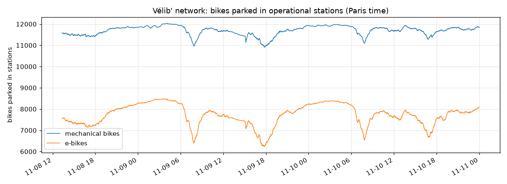
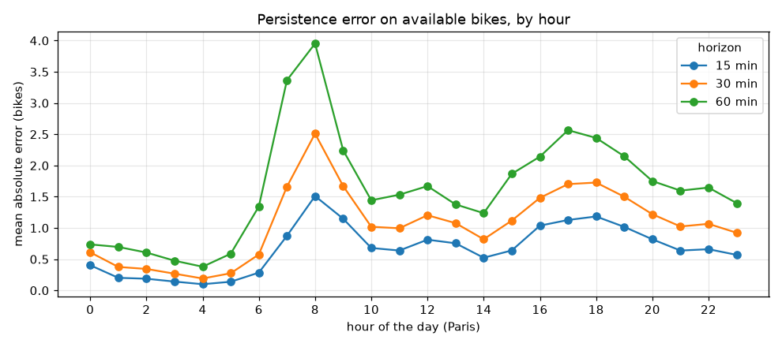
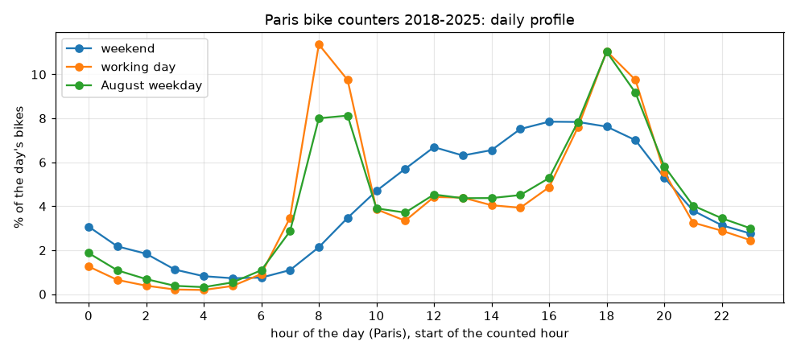

# Exploratory data analysis

Measured on the first three days of collection (8-10 November 2026, about
3,450 feed versions and 5.3 million station rows) and on ten years of City of
Paris bike counts (2018-2025). Every number below comes from a script in
`scripts/eda/` that reads the data through `veloflow.datasets`, so it can be
recomputed as the history grows:

```powershell
uv run python scripts/eda/01_overview.py --data-dir data --start 2026-11-08
uv run python scripts/eda/02_persistence_events.py --data-dir data --start 2026-11-08
uv run python scripts/eda/03_neighbors.py --data-dir data --start 2026-11-08
uv run python scripts/eda/04_counters.py --data-dir data
```

Three days is short. Results on transitions between minutes (persistence,
empty and full episodes, neighbours) rest on about a million grid points and
did not move when the third day was added. Anything about weekdays, weather or
seasons comes from the bike counters, not from our own data yet.

## 1. What the network looks like



- Stations are operational (installed, renting and returning) 98.4 % of the
  time.
- Among operational stations: no bike at all 5.0 % of the time, **no
  mechanical bike 21.4 %**, no e-bike 12.7 %, no free dock 2.8 %. "There are
  bikes" does not mean "there is the bike I want": targets are kept per bike
  type, as the specification asks.
- On a working day bikes leave the stations at 8:00 and 18:00. E-bikes drop
  about twice as much as mechanical bikes at peak hours.

## 2. Persistence is the baseline to beat

Persistence predicts that a station in `h` minutes will look exactly as it does
now. On a 5-minute grid (as-of join, no look-ahead):

| Horizon | MAE on available bikes | Unchanged | Within 2 bikes |
|---|---|---|---|
| 15 min | 0.69 | 57 % | 94 % |
| 30 min | 1.09 | 45 % | 88 % |
| 60 min | 1.68 | 34 % | 78 % |



The error at 60 minutes goes from 0.4 bike at 4:00 to 4.1 bikes at 8:00. A
daily average hides almost everything: **metrics are reported by hour**.

Persistence as a predictor of events at `t + 60 min`:

| Event | Base rate | Missed by persistence (the station was not in that state at `t`) |
|---|---|---|
| Empty | 4.8 % | **49 %** |
| Full | 2.6 % | **48 %** |
| No e-bike | 12.3 % | 42 % |
| No mechanical bike | 21.1 % | 20 % |

Half of the stations empty in an hour were not empty when the forecast was
made. That is where a model can add value; at 15 minutes persistence is close
to unbeatable.

Empty episodes last 20 minutes at the median (90th percentile 90 minutes) and
touch 741 stations in three days; full episodes last 15 minutes. One tenth of
the stations hold about a third of the empty or full time. The top of that
ranking is polluted by two stations that never change (one "empty" for
3,515 minutes in a row): suspected frozen stations, rule R4 of
[data quality](quality.md).

## 3. Neighbours tell more than the station itself

The nearest station is 230 m away at the median (90 % within 523 m); 68 % of
stations have a neighbour within 300 m, about four minutes on foot.

| Correlation with a station's change over the **next** 60 minutes | r |
|---|---|
| Mean change of its 5 nearest stations over the last 15 minutes | **+0.163** |
| Its own change over the last 15 minutes | +0.098 |
| Change of the whole network | +0.045 |
| Mean change of 5 random stations more than 3 km away (control) | +0.003 |

Correlations are low in absolute terms (counts of a few bikes are noisy), but
the ordering is clear and the distant control group is at zero. An empty
neighbour also raises the risk of an unforeseen empty station:

| Station now | One of the 5 nearest empty now | Empty in 60 min |
|---|---|---|
| 3 bikes or more | no | 0.47 % |
| 3 bikes or more | yes | 2.86 % (x6) |
| 2 bikes or fewer | no | 10.7 % |
| 2 bikes or fewer | yes | 18.0 % (x1.7) |

Why neighbours lead is not established yet (demand moving through an area,
or trucks rebalancing several nearby stations); rebalancing detection will
tell.

## 4. Calendar, seasons and weather (bike counters, 2018-2025)

Ten years of hourly counts from the City of Paris ([counters](counters.md)),
2020 and the first half of 2021 excluded (lockdowns, curfews). Each
counter-day is divided by the median of the same counter's ordinary Tuesdays
to Thursdays of the same year: 224,681 counter-days on 335 counters, and
ratios that do not depend on how many counters exist each year. These counts
measure cycling in general, not Vélib' rentals: they give the size and shape
of the effects.

| Day | Ratio | Month (working days) | Ratio |
|---|---|---|---|
| Monday | 0.93 | January | 0.70 |
| Friday | 0.89 | March | 0.90 |
| Saturday | 0.61 | June | **1.11** |
| Sunday | 0.53 | July | 0.94 |
| **Public holiday on a weekday** | **0.52** | **August** | **0.69** |
| School holiday weekday (not August) | 0.79 | September | **1.11** |
| August weekday | 0.69 | November / December | 0.93 / 0.80 |



The day type changes the **shape** of the day, not only its volume: two
peaks on working days (11.4 % of the day's bikes between 8:00 and 9:00), one
broad afternoon hump at weekends, and in August the morning peak flattens
(8 %) while the evening one stays.

Observed daily weather (ERA5 reanalysis, used here to measure an effect only;
model features use forecasts): heavy rain (10 mm or more) 0.79, moderate 0.87,
light 0.97, dry 1.03; below 5 °C 0.78, 15-25 °C 1.11. These are raw effects:
temperature is mixed up with the season.

## 5. Consequences for modelling

| Finding | Consequence |
|---|---|
| Persistence is close to unbeatable at 15 minutes and misses half of the empty stations at 60 | Value is measured at 30-60 minutes and on unforeseen events; persistence is the first baseline |
| Error varies tenfold with the hour | Every metric is reported by hour of the day |
| Empty and full are rare (5 % and 3 %) | Event metrics are precision-recall based, probabilities are calibrated |
| Neighbours lead the station | Neighbour features (recent change, empty or full state of the k nearest); a graph model is a candidate, to be compared with gradient boosting on those features |
| Public holidays behave like Sundays; the day type changes the daily profile | Calendar features crossed with the hour; a "profile by hour and day type" baseline |
| November 0.93, December 0.80 | Expect drift during our own test period; compare models within the same weeks |
| Frozen stations distort targets and rankings | Rule R4 before any training |
